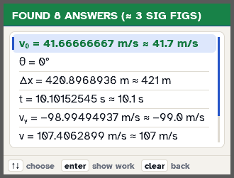
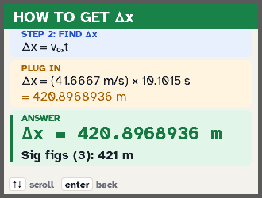

# PHYSPRO + PHYSICS Classic: TI-84 Plus CE physics solvers

by **Formula Foundry**. Need install help? Text 318-235-8861.

 

**PHYSPRO** ([`physpro/`](physpro)): a C app for the TI-84 Plus CE. Type what the problem gives you, leave the rest blank, and it solves every missing value with step-by-step work and sig figs. 12 topics and 97 formulas: vectors, motion, calculus motion, forces, work and energy, momentum, rotation, rolling, equilibrium, gravity, fluids, oscillations. It needs the arTIfiCE jailbreak on OS 5.5+.

## PHYSICS Classic (no jailbreak)

A menu-driven physics solver for the **TI-84 Plus CE**. Pick what you're solving for and what the problem gives you, type the numbers, and it shows the **formula**, the **plug-in line with units**, and the **answer with correct sig figs**. You never type letters. Plain TI-BASIC, so no jailbreak is needed.

**Website and download:** https://peytonalexander2021-source.github.io/ti84-physics-solver/

## Covers
- 1-D motion: average velocity, x-t / v-t graphs, constant acceleration (any 3 of 5), free fall, a(t) → v(t) → x(t)
- Vectors: components, magnitude and angle (with quadrant steps), adding vectors, 3-D, dot and cross product
- Projectiles and relative motion: horizontal and angled launch, plane drop, boat in a river, plane in wind
- Forces: F = ma, push/pull at an angle, friction, ramps, elevators, pulleys, Atwood machines, blocks in contact, drag and terminal speed
- Circular motion: centripetal force, period and RPM, max speed on curves and hills
- Unit converter, metric prefixes, automatic sig figs, concept cheat sheet

## Install
1. Install **TI Connect CE** (free) from education.ti.com.
2. Send all 7 files in [`programs/`](programs) to the calculator (helpers can go to Archive).
3. Press `prgm` → `PHYSICS` → `enter` `enter`.

Uses degrees and g = 9.8 m/s².

## Support
It's free. If it saved you time, a $1 Venmo tip to **@FormulaFoundry** ("physics solver" in the note) keeps it updated. Energy and momentum tools are next.

Check your instructor's calculator policy before using any program on a test.
